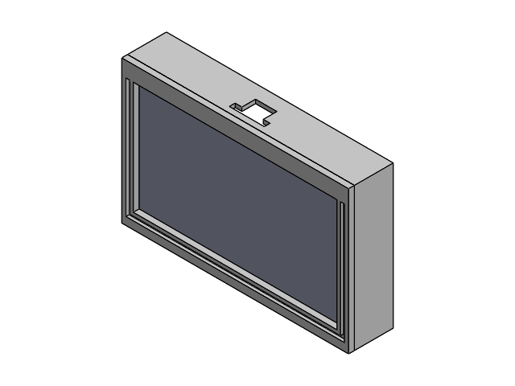
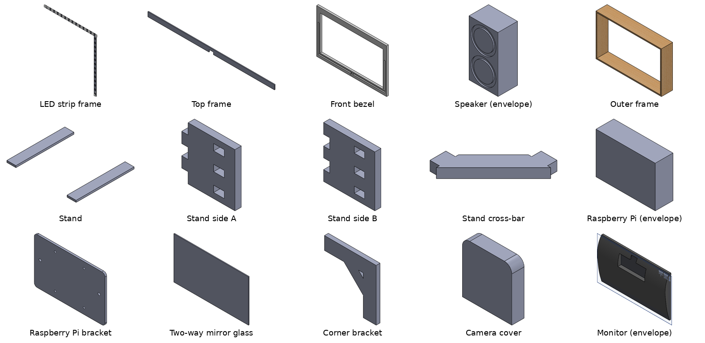
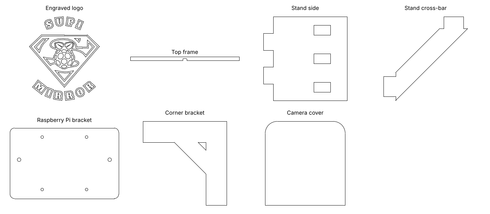

# SuPi Mirror: Smart Mirror (Google Hardware Product Sprint 2023)

A Raspberry Pi 4 smart mirror built during the **Google Hardware Product Sprint (HPS) 2023** (Jun - Sep 2023), demonstrated at the showtime and 15-minute final presentation on 1 Sep 2023. I led a five-person team, designed the enclosure in SolidWorks, and wrote the photo-capture / QR-code download module.



## What it does

A monitor sits behind mirror glass inside a wooden frame. The Raspberry Pi 4 runs [MagicMirror²](https://github.com/MagicMirrorOrg/MagicMirror) with a clock, calendar, weather and news feed, plus our custom modules. A camera above the glass lets users take a photo on the mirror and download it to their phone by scanning a QR code.

## Photo capture -> QR-code download (`software/TakePicture_QRcode/`)

My MagicMirror² module. The flow:

```
"Smile" button on mirror UI (TakePicture_QRcode.js)
   -> socket notification -> node_helper.js spawns TakePictureFinal.py
   -> OpenCV grabs a frame from the USB camera, saves img/photoN.jpg
   -> pyqrcode writes a QR code pointing at http://<pi-ip>:8888/img/photoN.jpg
   -> a Tornado static-file server (separate thread) serves the photo
   -> the user scans the QR code and downloads the photo on their phone
```

| File | Role |
|---|---|
| `TakePicture_QRcode.js` | Front-end module: photo preview and the buttons on the mirror |
| `node_helper.js` | Back-end helper: receives the button event and runs the Python script |
| `TakePictureFinal.py` | Camera capture (OpenCV), QR-code generation (pyqrcode), Tornado file server on port 8888, photo counter in `count.json` |
| `TakePicture_QRcode.css` | Module styling |

`software/config.example.js` is the MagicMirror² configuration we ran (credentials replaced with placeholders). To try the module, copy the folder into `MagicMirror/modules/`, add `{ module: "TakePicture_QRcode", position: "middle_right" }` to your config, set the Raspberry Pi's IP and paths at the top of `TakePictureFinal.py`, and `pip install opencv-python pyqrcode pypng tornado`.

This is the code as it ran at the 2023 demo, kept unchanged: the IP address and home-directory paths are hard-coded, and the capture is confirmed with the `q` key in the OpenCV preview window.

## Enclosure (`cad/`)

Front bezel 583.7 x 368.4 x 15 mm with a 524 x 290 mm display window; the outer frame is 100 mm deep with a notch on top for the camera. Flat parts were exported as DXF for laser cutting, including the engraved "SuPi Mirror" logo.





| File (`cad/solidworks/`) | Part |
|---|---|
| `組合件1.SLDASM` | Top-level assembly |
| `外框.SLDPRT` / `外框.SLDDRW` | Outer frame + drawing |
| `前擋板.SLDPRT` / `前擋板.SLDDRW` | Front bezel + drawing |
| `上框.SLDPRT` | Top frame strip |
| `玻璃.SLDPRT` | Mirror glass |
| `支撐架.SLDPRT`, `支撐架一側.SLDPRT`, `支撐架另一側.SLDPRT`, `支撐架桿桿.SLDPRT` | Stand: legs, two side plates, cross-bar |
| `角落固定片.SLDPRT` | Corner bracket |
| `樹梅派固定架.SLDPRT` | Raspberry Pi mounting plate |
| `鏡頭蓋.SLDPRT` | Camera cover |
| `LED.SLDPRT` | LED strip |
| `電腦.SLDPRT`, `樹梅派.SLDPRT`, `喇叭.SLDPRT` | Monitor, Raspberry Pi and speaker models used for fit checks |

`cad/dxf/` holds the laser-cutting files (`SuPiMirror.dxf` / `.svg` is the logo), and `cad/drawings/` has image exports of the two drawings.

## Not included

- Modules written by teammates and third-party MagicMirror² modules (face recognition, Google Assistant, and others referenced in the config).
- Team meeting notes, the presentation recording and test photos.

## Credits

- Team leader, enclosure CAD and the photo-capture / QR-code module: Kai-Chun Chang.
- Built with four teammates in the Google Hardware Product Sprint 2023.
- This README and the part previews (extracted from the SolidWorks files) were prepared in October 2026 with help from an AI assistant (Claude); the CAD files and code are the August 2023 originals, except that credentials in `config.example.js` were replaced with placeholders.
