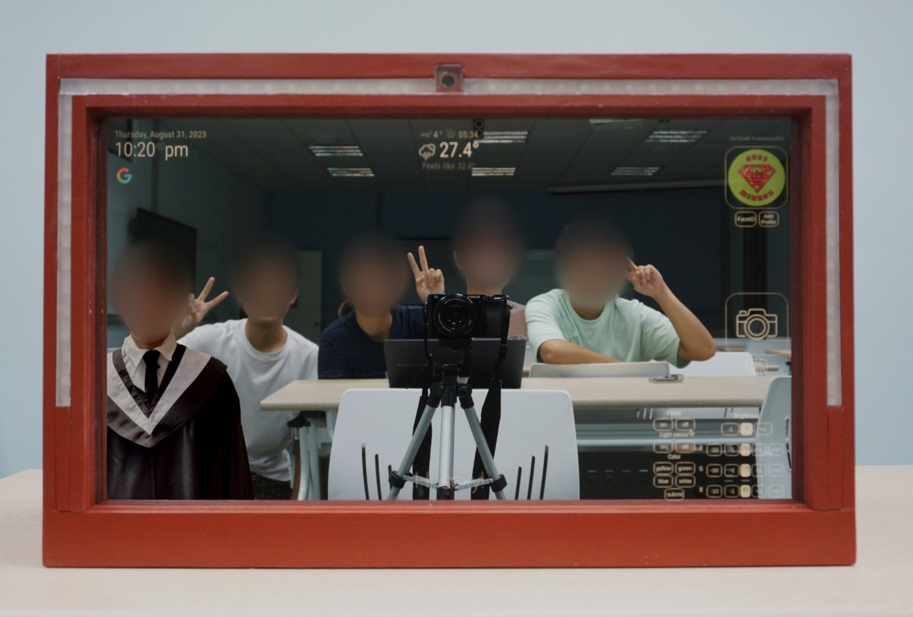
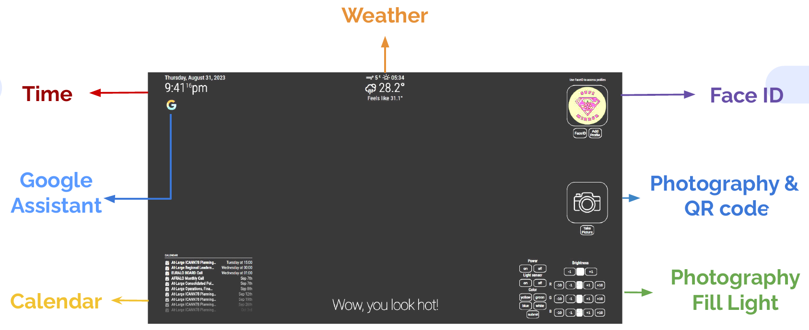
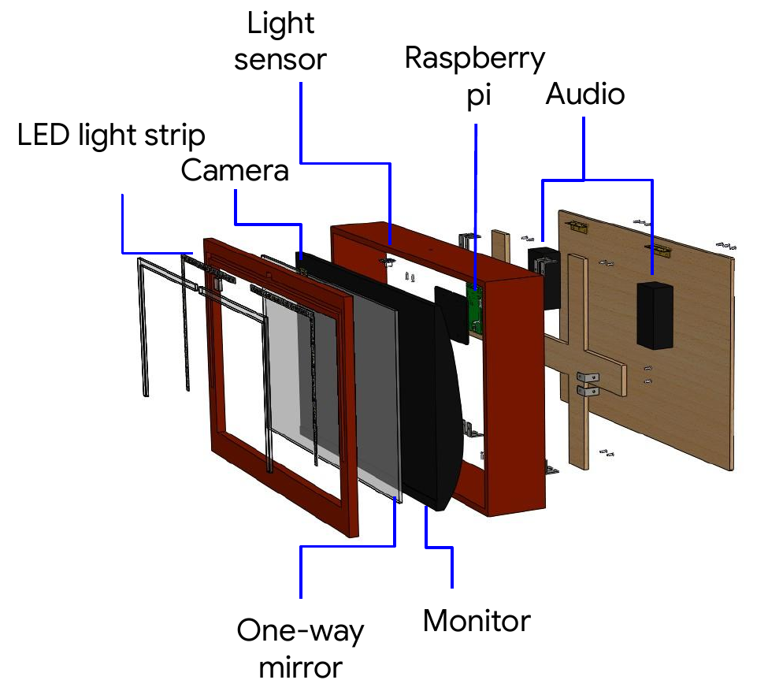

# SuPi Mirror: Smart Mirror (Google Hardware Product Sprint 2023)

A Raspberry Pi smart mirror built by Team 2 of the **Google Hardware Product Sprint (HPS) 2023**, a nine-week sprint (7 Jul - 31 Aug 2023) mentored by Google Taiwan, demonstrated at the showtime and final presentation on 1 Sep 2023. I was the team's program manager, designed and built the enclosure, and wrote the photo-capture / QR-code download module and parts of the UI.


<sub>The finished mirror, with the team reflected in it (faces blurred).</sub>

**Demo video:** [2023 Google HPS Team2 Supi Mirror](https://youtu.be/KylhJfvARUk) (YouTube)

## Features



The Raspberry Pi runs [MagicMirror²](https://github.com/MagicMirrorOrg/MagicMirror) behind a one-way mirror:

- **Time, weather, calendar, news** -- OpenWeather and Google Calendar feeds.
- **Google Assistant** -- voice Q&A, a Bard chatbot, and Spotify playback with volume control.
- **Face ID** -- users log in or register with the camera and the mirror shows their profile.
- **Photography & QR code** -- take a selfie on the mirror and download it to your phone by scanning a QR code (my module, below).
- **Photography fill light** -- an RGB LED strip around the mirror with on/off, colour and brightness controls, plus auto-brightness from a light sensor.

## Structure design



From front to back: LED light strip, front bezel, one-way mirror, monitor, outer frame (camera on top, light sensor), Raspberry Pi, speakers, and a wooden back panel with a stand.

- Front bezel 583.7 x 368.4 x 15 mm with a 524 x 290 mm display window; the outer frame is 100 mm deep with a notch on top for the camera.
- Flat parts were exported as DXF for laser cutting, including the engraved SuPi Mirror logo (the Superman shield and Raspberry Pi logo combined).


| File (`cad/solidworks/`) | Part |
|---|---|
| `組合件1.SLDASM` | Top-level assembly |
| `外框.SLDPRT` / `外框.SLDDRW` | Outer frame + drawing |
| `前擋板.SLDPRT` / `前擋板.SLDDRW` | Front bezel + drawing |
| `上框.SLDPRT` | Top frame strip |
| `玻璃.SLDPRT` | One-way mirror glass |
| `支撐架.SLDPRT`, `支撐架一側.SLDPRT`, `支撐架另一側.SLDPRT`, `支撐架桿桿.SLDPRT` | Stand: legs, two side plates, cross-bar |
| `角落固定片.SLDPRT` | Corner bracket |
| `樹梅派固定架.SLDPRT` | Raspberry Pi mounting plate |
| `鏡頭蓋.SLDPRT` | Camera cover |
| `LED.SLDPRT` | LED strip |
| `電腦.SLDPRT`, `樹梅派.SLDPRT`, `喇叭.SLDPRT` | Monitor, Raspberry Pi and speaker models used for fit checks |

`cad/dxf/` holds the laser-cutting files (`SuPiMirror.dxf` / `.svg` is the logo), and `cad/drawings/` has image exports of the two drawings.

## Photo capture -> QR-code download (`software/TakePicture_QRcode/`)

My MagicMirror² module. The flow:

```
"Take Picture" button on the mirror UI (TakePicture_QRcode.js)
   -> socket notification -> node_helper.js spawns TakePictureFinal.py
   -> OpenCV grabs a frame from the camera, saves img/photoN.jpg
   -> pyqrcode writes a QR code pointing at http://<pi-ip>:8888/img/photoN.jpg
   -> a Tornado static-file server (separate thread) serves the photo
   -> the user scans the QR code and downloads the photo on their phone
```

| File | Role |
|---|---|
| `TakePicture_QRcode.js` | Front-end module: photo preview and the buttons on the mirror |
| `node_helper.js` | Back-end helper: receives the button event and runs the Python script |
| `TakePictureFinal.py` | Camera capture (OpenCV), QR-code generation (pyqrcode), Tornado file server on port 8888, photo counter in `count.json` |
| `TakePicture_QRcode.css` | Module styling |

`software/config.example.js` is the MagicMirror² configuration we ran (credentials replaced with placeholders). To try the module, copy the folder into `MagicMirror/modules/`, add `{ module: "TakePicture_QRcode", position: "middle_right" }` to your config, set the Raspberry Pi's IP and paths at the top of `TakePictureFinal.py`, and `pip install opencv-python pyqrcode pypng tornado`.

This is the code as it ran at the 2023 demo, kept unchanged: the IP address and home-directory paths are hard-coded, and the capture is confirmed with the `q` key in the OpenCV preview window.

## Schedule

| Weeks | Milestone |
|---|---|
| 1-4 (7/7 - 7/27) | Research advanced functions; photography & QR code, fill light and UI programming complete |
| 5-6 (8/3 - 8/10) | First part complete; modules inserted into MagicMirror²; enclosure design and module testing |
| 7 (8/17) | System integration |
| 8-9 (8/24 - 8/31) | Product complete, demo |

## Lessons learned

- **Pros:** finished look, many functions in one mirror, easy to use, Bard integration.
- **Cons:** no touch screen, heavy.
- **Challenges:** designing a complete user interface; integrating modules written by five people on one Raspberry Pi.
- **Future work:** touch screen, full-length mirror, Google Assistant control of every module, weather-based outfit recommendations with one-click ordering.

## Team

Mentor: Dave He (Google).

| Member | Responsibility |
|---|---|
| **Kai-Chun Chang** | Photography & QR code, product design & implementation, UI, demo, program management |
| Jia-Cheng Li | Photography fill light, presentation |
| Chia-Chien Cheng | Time, weather, calendar, news, Spotify, logo design, presentation |
| Tse Liang | Google Assistant, calendar and Spotify integration, system integration, UI, demo |
| Pei-Shin Hwang | Face ID, system integration, demo, video editing |

## Not included

- Code written by teammates (fill light, Face ID, Google Assistant and the other modules) and third-party MagicMirror² modules referenced in the config.
- Meeting notes, the presentation file, its recording and test photos.

## Credits

- Enclosure CAD and the photo-capture / QR-code module: Kai-Chun Chang. Team roles are as listed in the team's final presentation.
- This README, the part previews (extracted from the SolidWorks files) and the face blurring were prepared in October 2026 with help from an AI assistant (Claude). The CAD files and code are the August 2023 originals, except that credentials in `config.example.js` were replaced with placeholders.
